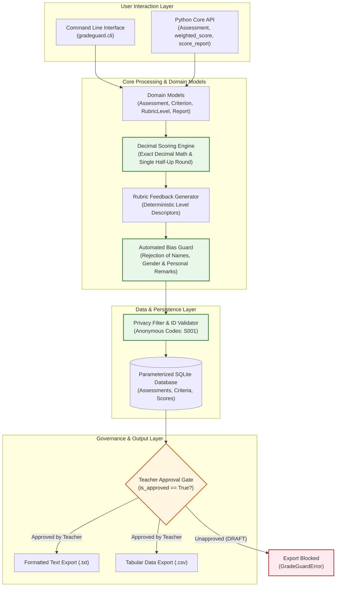

# GradeGuard

[](https://www.python.org/)
[](tests/)
[](tests/)
[](.flake8)
[](docs/quality_report.txt)
[](gradeguard/)

**GradeGuard** is a clean, privacy-safe, rubric-based assessment grading system designed for university education. It replaces biased or subjective AI-written feedback with deterministic, rubric-bound feedback, enforces exact Decimal math with zero rounding drift, and guarantees student privacy by strictly forbidding the storage of real student names or raw student work.

---

## 🏛️ System Architecture & Block Diagram

GradeGuard enforces a layered, deterministic architecture where student privacy, mathematical fidelity, and human-in-the-loop oversight are guaranteed by software invariants.

### 1. High-Level System Block Diagram



### 2. Architectural Dataflow

```
Teacher Defines Rubric            Teacher Submits Marks         Core Engine & Bias Guard
┌───────────────────────┐        ┌────────────────────┐        ┌─────────────────────────────┐
│ Assessment Title      │  ───►  │ Anonymous ID: S001 │  ───►  │ 1. Decimal Weighted Score   │
│ Criteria & Weights    │        │ Marks per Criterion│        │ 2. Rubric Level Match       │
│ Level Descriptors     │        └────────────────────┘        │ 3. Automated Bias Screening │
└───────────────────────┘                                      └──────────────┬──────────────┘
                                                                              │
                                                                 Stores as DRAFT (is_approved=0)
                                                                              ▼
Export to .TXT / .CSV     ◄─── [EXPORT ALLOWED] ◄─── Teacher Calls ─── [APPROVAL GATE]
(Official School Record)                              approve()        Blocks Unapproved Export
```

---

## 📁 Project Structure

```
N233_Abhinav_Gupta_AIRSD_CaseStudy_code/
│
├── gradeguard/                     # Core Python Package (Standard Library Only)
│   ├── __init__.py                 # Public package exports, versioning, and backwards compatibility
│   ├── __main__.py                 # CLI executable entrypoint (python -m gradeguard)
│   ├── cli.py                      # Production argparse CLI (create, add-criterion, grade, approve, export)
│   ├── feedback.py                 # Rubric descriptor selector and automated BiasGuard filter
│   ├── gradeguard.py               # Backwards-compatibility wrapper for legacy prototype callers
│   ├── models.py                   # Domain models: Assessment, Criterion, RubricLevel, Report, GradeGuardError
│   ├── report.py                   # Score report generation, approval gating, and text/csv exporters
│   ├── scoring.py                  # Exact Decimal calculations and single-step half-up rounding
│   └── storage.py                  # SQLite persistence using 100% parameterized queries
│
├── tests/                          # Comprehensive Unit Test Suite (43 Tests, 92% Coverage)
│   ├── test_cli.py                 # CLI workflow, JSON parsing, flag parsing, and error-handling tests
│   ├── test_feedback.py            # Rubric descriptor tests, bias checks, and determinism proofs
│   ├── test_gradeguard.py          # Original legacy test suite (all passing without modification)
│   ├── test_models.py              # Models, custom rubric levels, and student ID privacy validation tests
│   ├── test_report.py              # Draft status, approval gating, and .txt/.csv export verification tests
│   ├── test_scoring.py             # Decimal precision, 33.3 split, and .xx5 rounding boundary tests
│   └── test_storage.py             # SQLite persistence, schema verification, and SQL-injection defense tests
│
├── docs/                           # Project Documentation & Quality Reports
│   ├── ACCEPTANCE.md               # Traceability matrix mapping every requirement to verifying unit tests
│   └── quality_report.txt          # Real Flake8 static analysis and Bandit security audit logs
│
├── .flake8                         # PEP 8 linting configuration
├── .gitignore                      # Git ignore patterns for Python, pytest, and SQLite artifacts
├── CHANGELOG.md                    # Detailed changelog documenting all additions, changes, and fixes
├── README.md                       # Comprehensive project documentation (this file)
└── requirements-dev.txt            # Development dependencies (pytest, pytest-cov, flake8, bandit)
```

---

## 🛡️ Core Pillars & Design Invariants

1. **Exact Decimal Arithmetic & Half-Up Rounding**:
   - Uses Python's standard `decimal.Decimal` across all models and calculations.
   - Eliminates binary floating-point drift (e.g., weights `33.3% + 33.3% + 33.4%` total exactly `100.0%`).
   - Rounds once at the very end using `ROUND_HALF_UP` to two decimal places, correctly handling boundary values like `50.005 -> 50.01` and `50.0049 -> 50.00`.

2. **Strict Student Privacy & Anti-Surveillance**:
   - Accepts **only anonymous student identifiers** (e.g., `S001`, `ANON_42`).
   - Validates input to immediately reject real student names, spaces, commas, or raw student essay submissions.
   - Zero storage of student work; no external API or cloud calls.

3. **Rubric-Driven Determinism & Bias Guard**:
   - Feedback comments are strictly mapped to predefined rubric level descriptors matching the student's mark range.
   - The automated **Bias Guard** screens feedback and rejects any gendered words (`he`, `she`, `him`, `her`), personal remarks (`lazy`, `smart`, `attitude`), or personal names.
   - **Guaranteed Fairness:** Two students with identical marks will always receive 100% identical feedback.

4. **Human-in-the-Loop Approval Workflow**:
   - Every generated score report starts in `DRAFT` status (`is_approved = False`).
   - The software physically forbids exporting reports until an educator explicitly runs `approve()`.

5. **SQL Injection Immune Persistence**:
   - SQLite persistence exclusively uses parameterised queries (`?` placeholders).
   - SQL injection attack payloads (e.g., `Robert'); DROP TABLE assessments;--` and `' OR '1'='1`) are completely neutralized.

---

## 🚀 Installation & Setup

GradeGuard requires **Python 3.9+** and uses **only the standard library** for core functionality.

To install the optional development and testing tools:

```bash
# Windows (py launcher)
py -m pip install -r requirements-dev.txt

# Linux / macOS
pip install -r requirements-dev.txt
```

---

## 🧪 Running Automated Tests

Run the full test suite with test coverage:

```bash
# Run pytest with code coverage (43 tests, 92% coverage):
py -m pytest -v --cov=gradeguard --cov-report=term-missing

# Run standard unittest discovery:
py -m unittest discover -s tests -v
```

### Coverage Summary

| Module | Statements | Missing | Coverage |
|---|---|---|---|
| `gradeguard/__init__.py` | 7 | 0 | **100%** |
| `gradeguard/scoring.py` | 24 | 0 | **100%** |
| `gradeguard/feedback.py` | 43 | 0 | **100%** |
| `gradeguard/storage.py` | 100 | 2 | **98%** |
| `gradeguard/report.py` | 78 | 2 | **97%** |
| `gradeguard/models.py` | 117 | 7 | **94%** |
| `gradeguard/cli.py` | 190 | 23 | **88%** |
| **Total** | **570** | **45** | **92%** |

---

## 🔍 Code Quality & Security Audits

```bash
# Run PEP 8 static analysis (0 errors, 0 warnings):
py -m flake8 gradeguard tests

# Run security vulnerability scan (0 issues):
py -m bandit -r gradeguard
```
*Official audit logs are recorded in [`docs/quality_report.txt`](docs/quality_report.txt).*

---

## 💻 Command-Line Interface (CLI) Guide

GradeGuard provides a complete CLI: `python -m gradeguard <command>` (or `py -m gradeguard`).

### 1. Create an Assessment
```bash
py -m gradeguard create-assessment --title "History Essay 1"
```

### 2. Add Criteria (Weights must total exactly 100%)
```bash
py -m gradeguard add-criterion --assessment "History Essay 1" --name "Argument" --weight 40 --max-marks 10
py -m gradeguard add-criterion --assessment "History Essay 1" --name "Evidence" --weight 35 --max-marks 10
py -m gradeguard add-criterion --assessment "History Essay 1" --name "Clarity" --weight 25 --max-marks 10
```

*(Optional: Add custom rubric levels via JSON)*
```bash
py -m gradeguard add-criterion --assessment "History Essay 1" --name "Analysis" --weight 25 --max-marks 10 \
  --levels '[{"name": "Excellent", "min_mark": 8.0, "max_mark": 10.0, "descriptor": "Superb critical analysis."}, {"name": "Basic", "min_mark": 0.0, "max_mark": 7.9, "descriptor": "Basic conceptual grasp."}]'
```

### 3. Grade a Student (Anonymous ID: e.g. `S001`)
```bash
py -m gradeguard grade --assessment "History Essay 1" --student "S001" \
  --mark Argument=8 \
  --mark Evidence=6.5 \
  --mark Clarity=4
```
*Output:*
```text
Graded student S001 for assessment 'History Essay 1':
Weighted Score: 64.75% [Status: DRAFT (Teacher approval required)]
Feedback:
  - Argument: strong work, keep it up.
  - Evidence: developing, review the rubric descriptor for this criterion.
  - Clarity: needs work, please see your teacher for support.
```

### 4. Verify Approval Enforcement
Attempting to export an unapproved report is strictly blocked:
```bash
py -m gradeguard export --assessment "History Essay 1" --student "S001" --format txt
```
*Output:*
`Error: Cannot export unapproved report for student S001. A teacher must run 'approve' before export is allowed.`

### 5. Teacher Approves the Report
```bash
py -m gradeguard approve --assessment "History Essay 1" --student "S001" --teacher "Dr. Smith"
```

### 6. Export Approved Reports (.txt and .csv)
```bash
# Export to formatted text:
py -m gradeguard export --assessment "History Essay 1" --student "S001" --format txt --output report_S001.txt

# Export to tabular CSV:
py -m gradeguard export --assessment "History Essay 1" --student "S001" --format csv --output report_S001.csv
```

---

## 🐍 Python Library API Example

```python
from decimal import Decimal
from gradeguard import Assessment, score_report, weighted_score

# 1. Define assessment and criteria
assessment = Assessment("Final Dissertation")
assessment.add_criterion("Methodology", weight=Decimal("50"), max_marks=Decimal("10"))
assessment.add_criterion("Literature Review", weight=Decimal("50"), max_marks=Decimal("10"))
assessment.validate()

# 2. Calculate exact weighted score
marks = {"Methodology": Decimal("8.5"), "Literature Review": Decimal("7.0")}
score, details = weighted_score(assessment, marks)
print(f"Final Score: {score}%")  # 77.50%

# 3. Generate anonymous score report (starts in DRAFT)
report_str = score_report(assessment, "S105", marks)
print(report_str)
```

---

## 📄 Documentation Links
- [Acceptance Criteria Traceability Matrix](docs/ACCEPTANCE.md)
- [Code Quality & Security Report](docs/quality_report.txt)
- [Changelog](CHANGELOG.md)

---

## 👤 Author
**Abhinav Gupta**  
GitHub: [@abhinavgupta30](https://github.com/abhinavgupta30)
